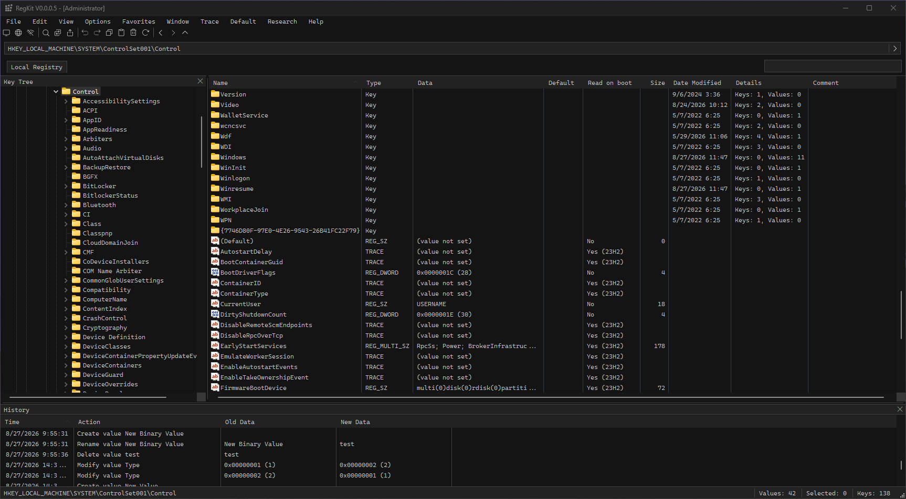
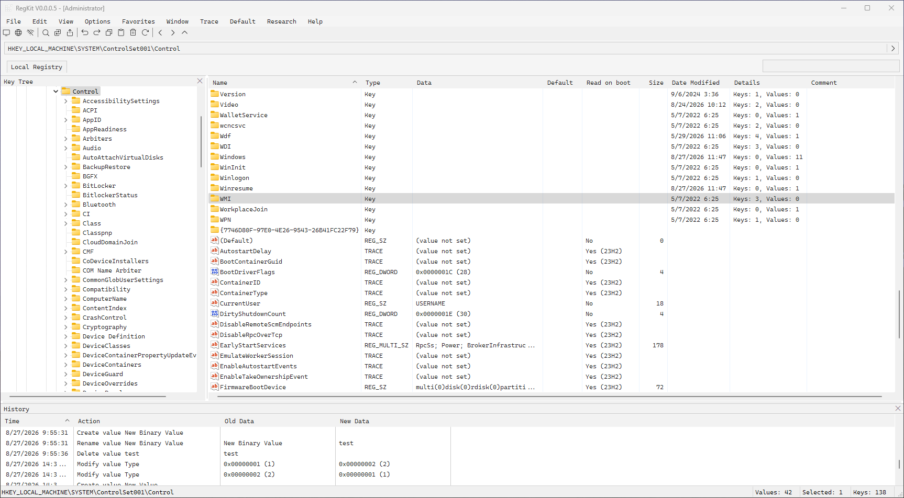
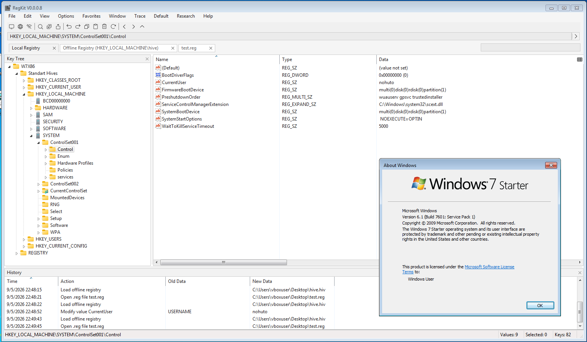

# RegKit

RegKit is a feature rich registry editor replacement, which includes several improvements & additions compared to the native RegEdit. It currently supports Windows Vista through Windows 11 (32bit & 64bit versions). Note that native RegEdit can't run alongside RegKit, as RegKit uses `RegEdit_RegEdit` window class (required for jump support), which causes RegEdit to see this window as an existing instance and exits instead of opening another one.

Whenever you're not a power user, `View > Simple Mode` mirrors the RegEdit UI layout and only keeps some essential additions (address bar, tabs, filter bar, undo/redo...).

## Installation

The binaries can be downloaded via the [releases](https://github.com/nohuto/regkit/releases), winget ([PR](https://github.com/microsoft/winget-pkgs/pull/455779) wasn't merged yet), scoop (will be added to [extras](https://github.com/ScoopInstaller/Extras) as soon as the repo has 100 stars) or by building them on your own.

```powershell
winget install nohuto.RegKit

scoop bucket add nohuto https://github.com/nohuto/regkit
scoop install nohuto/regkit
```

### Verify Binaries

All releases have a detached GPG sig, import the [public key](https://pgp.noverse.dev) and verify the file next to its sig:

```powershell
curl.exe -fsSL https://pgp.noverse.dev -o public.asc
gpg --import public.asc

gpg --verify RegKit-Setup-<version>-x64.exe.sig RegKit-Setup-<version>-x64.exe
gpg --verify RegKit-Portable-<version>-x64.zip.sig RegKit-Portable-<version>-x64.zip
gpg --verify regkit.exe.sig regkit.exe
```

It must show `Good signature from "nohuto <contact@noverse.dev>"`, made by the signing subkey `FF65 399D 1B28 95F6 CC34  BE79 1853 081F E103 04A2`.

## Differences/Additions

RegKit adds functionality that native RegEdit doesn't support:

- A `REGISTRY` root view in addition to the standard root keys, see [`\REGISTRY`](https://noverse.dev/docs/regkit/registry-internals/registry-fundamentals/#root-keys--registry)
- [Theme modes](https://noverse.dev/docs/regkit/overview/#theme-presets) (System/Light/Dark) and custom theme presets (edit colors, import/export `.rktheme` files)
- Supports several languages, which [you can edit/add on your own](https://noverse.dev/docs/regkit/overview/#translations), currently:
  - English
  - German
  - French
  - Spanish
  - Italian
  - Japanese
  - Simplified Chinese
  - Korean
  - Russian
  - Brazilian Portuguese
- Custom font support
- Custom [icon sets](https://noverse.dev/docs/regkit/overview/#icon-sets), with two sets included by default
- [Symbolic link](https://noverse.dev/docs/regkit/registry-internals/registry-fundamentals/#symbolic-links) detection, including the link target
- [Loaded hive root](https://noverse.dev/docs/regkit/registry-internals/registry-fundamentals/#loaded-hives) detection and an *On-Disk Hive File* command for the backing file
- File conversion, converts between `.reg` (Regedit 5 & ANSI `REGEDIT4`), `.bat`/`.cmd` (`reg add`/`reg delete`) & `.ps1`, or from a root key to any of them
- [Trace presets](https://noverse.dev/docs/regkit/overview/#trace-menu) for 23H2, 24H2, 25H2, which fill the `Read on boot` column
- Default presets from Windows installations, which fill the `Default` column (and "Reset to Default" which is disabled by default)
- An extra root keys toggle for [predefined keys](https://noverse.dev/docs/regkit/registry-internals/registry-fundamentals/#predefined-keys) that RegEdit doesn't show
- Switching between [User, Admin, SYSTEM, and TrustedInstaller rights](https://noverse.dev/docs/regkit/overview/#rights-and-elevation) (*HKCU Follows Signed-In User*, shows the signed in users hive as `HKEY_CURRENT_USER` when running as SYSTEM/TrustedInstaller)
- Favorites import/export
- Comment column for values/keys (including [default comments](https://github.com/nohuto/regkit/blob/main/assets/comments/default-comments.jsonc))
- Decoding values (B64, hex...), interpreting values as `FILETIME`, `SYSTEMTIME`, GUID, SID, security descriptor, IPv4/IPv6...
- [Edit Bits](https://noverse.dev/docs/regkit/overview/#bit-definitions), a bit editor for DWORD, big endian DWORD, QWORD and REG_BINARY values, with reusable JSON definitions that name each bit
- Resource list viewer for `REG_RESOURCE_LIST`, `REG_FULL_RESOURCE_DESCRIPTOR` & `REG_RESOURCE_REQUIREMENTS_LIST` values
- [Key handles](https://noverse.dev/docs/regkit/registry-internals/registry-fundamentals/#key-handles)
- Key Information window (native name, hive file, class name, last write time, volatile/symbolic link state, UAC virtualization flags/state, integrity level...)
- Loading/unloading hives, saving keys as hive files & restoring keys from them
- Local (64-bit & 32-bit view, *Go to Other View* between them), remote, offline registries
- *Go to Virtual Store Copy*, *Go to Global Key* (UAC virtualization)
- *Open in Source Hive* for merged `HKEY_CLASSES_ROOT` keys
- Creating symbolic links & volatile keys
- Undo/redo, copy/paste, replace
- Performant 'Find' with several options (source, anomalies, regex...)
- PCRE2 regular expressions for Find/Replace, see [pcre2syntax](https://pcre2project.github.io/pcre2/doc/pcre2syntax/) & [pcre2pattern](https://pcre2project.github.io/pcre2/doc/pcre2pattern/)
- Address bar accepts multiple registry path formats (abbreviated HK*, full root, RegEdit address bar, `.reg` header, `reg:` link, PowerShell drive/provider, escaped)
- Copy Key Path As menu for the same formats (to copy/paste into the address bar) & native `REGISTRY` paths
- Copy Value Name / Copy Value Data from value context menus
- Open links found in value data or comments
- Tab control
- Tab session restore with *Save Tabs* and *Clear Tabs on Exit*, including cached Find results
- Filter bar for the value list
- History view
- Option to save/forget previous key tree state
- Auto refresh of the opened key (off by default)
- [Backup/restore privilege mode](#rights-and-elevation) for keys whose permissions deny access
- Simulated keys from traces
- Compare Registries
- Drag and drop support for `.reg` files, hive files, folders
- *Edit with RegKit* context menu for `.reg` and hive files
- Read only mode
- Simple mode (hides some features)
- Miscellaneous common functionalities

## Translations

Please note that the translations I've made are auto generated using resources such as MS terminology, language style guides, etc., but may still have inaccuracies. **English is currently the only verified language.** If you are a native speaker of one of the supported languages, I would appreciate your feedback and corrections.

RegKit uses your display language if a matching language pack is installed by default, `Options > Language` can be used to change it manually. CLI output, files RegKit writes (exports, conversions, settings)/names (themes, traces, research links, `REG_*`/`HKEY_*`) won't be translated.

### Adding a Language

Whenever UI text changes in the source, rerun `translations.ps1` as shown below again, which then regenerates `regkit.pot`,  and merges it into every `.po`.

1. Run `.\translations.ps1 -gettext <folder with xgettext.exe> -language <code>` ([GNU gettext download](https://mlocati.github.io/articles/gettext-iconv-windows.html)), `<code>` = language name (e.g. `fr`, `pt-BR`), which generates `regkit.pot` from the current source and creates `assets/lang/<code>.po`
2. Translate it with any PO editor, keep `&` access keys, `%` placeholders and `\n` line breaks (empty entries fall back to english)
3. Add the pack to `installer/regkit.iss`, two `lang\<code>` component lines with the primary language ID and one file line (see existing `de` entries)

Or copy the `.po` into `assets\lang`, which would show up in `Options > Language` without rebuilding.

## Theme Presets

It includes built in presets and a theme editor to customize colors, presets can also be saved, exported/imported as `.rktheme` files.

### Previews

#### Default Dark



##### W7 Dark


#### Default Light



##### W7 Light



#### Gruvbox Dark


#### Kanagawa Wave


## Icon Sets

Use `Options > Icons` to switch between the built-in sets:

- Classic ([win-icons](https://github.com/nohuto/win-icons))
- Phosphor (default)

You can set your own ico set via `%LOCALAPPDATA%\Noverse\RegKit\icons` (use naming of icons listed below). If `icons\dark` and `icons\light` exist, regkit uses them for dark/light modes, if not it will use the root `icons` folder for both modes.

See [win-icons](https://github.com/nohuto/win-icons) for a collection of icons, which you can use to create your own set.

### Previews

| Icon | Classic | Phosphor |
| --- | --- | --- |
| `local-registry` |  |  |
| `remote-registry` |  |  |
| `offline-registry` |  |  |
| `search` |  |  |
| `replace` |  |  |
| `undo` |  |  |
| `redo` |  |  |
| `copy` |  |  |
| `paste` |  |  |
| `delete` |  |  |
| `refresh` |  |  |
| `back` |  |  |
| `forward` |  |  |
| `up` |  |  |

## Icon Meanings

### Symlink Icon 

See [registry-fundamentals#symbolic-links](https://noverse.dev/docs/regkit/registry-internals/registry-fundamentals/#symbolic-links).

### Database Icon 

The '*On-Disk Hive File*' command opens the backing file.

See [registry-fundamentals#loaded-hives](https://noverse.dev/docs/regkit/registry-internals/registry-fundamentals/#loaded-hives).

### Simulated Key Icon 

Keys displayed as simulated are virtual entries created from trace files when a key exists in a trace but not in the actual hive view. They're displayed with the *folder-sim* icon so you can differ them from real keys. Creating or modifying a value in a simulated key will create the key path on demand.

### Volatile Key Icon 

Volatile keys only exist in memory and are gone after a reboot. `Edit > New > Volatile Key` creates one, a volatile key can only have volatile subkeys.

### Access Denied Icons  

The key (or loaded hive root) exists, but its permissions deny reading it with the current rights. See [Rights and Elevation](#rights-and-elevation) for ways to open it anyway.

## Bit Definitions

RegKit has currently three files for [ShellState](https://github.com/nohuto/regkit/blob/main/assets/bitfields/ShellState.regkit-bitfield.jsonc) ([explorer-options/#shellstate](https://noverse.dev/docs/win-config/visibility/explorer-options/#shellstate)), [UserPreferencesMask](https://github.com/nohuto/regkit/blob/main/assets/bitfields/UserPreferencesMask.regkit-bitfield.jsonc) ([minimal-visual-effects/#userpreferencesmask](https://noverse.dev/docs/win-config/visibility/minimal-visual-effects/#userpreferencesmask)) & [NVIDIA RM values](https://github.com/nohuto/regkit/blob/main/assets/bitfields/NVIDIA.regkit-bitfield.jsonc) (previously [bitmask-calc](https://github.com/nohuto/bitmask-calc) which is now archived), see [`nvvalues.txt`](https://github.com/nohuto/bitmask-calc/blob/main/nvvalues.txt) for a list of all values.

### JSON Format

See the JSON files above for complete examples.

```json
{
  "format": "regkit-bitfield",
  "name": "Example definitions",
  "comment": "Comment about the file",
  "definitions": [
    {
      "name": "Example value flags",
      "value_name": "ExampleValue",
      "key_paths": [ "\\Software\\Example" ],
      "bit_width": 32,
      "byte_offset": 0,
      "comment": "Explanation of the value",
      "fields": [
        {
          "name": "Name",
          "bits": [0, 1],
          "meaning": "Explanation of what the field does",
          "states": [
            { "value": 0, "name": "Off" },
            { "value": 2, "name": "On", "meaning": "On if both bits are set" }
          ]
        },
        {
          "name": "Another name",
          "bits": [4, 5, 6],
          "meaning": "Explanation of what the bitfield does"
        }
      ]
    }
  ]
}
```

#### Members

| Member | | Required | Meaning |
| --- | --- | --- | --- |
| `format` | file | yes | Always `regkit-bitfield` |
| `name` | file | no | Shown in the `Bit Definitions` submenu |
| `comment` | file | no | Comment about the file itself |
| `definitions` | file | yes | One entry per described value |
| `name` | definition | no | Shown in the definition list. Falls back to `value_name` |
| `value_name` | definition | yes | Registry value name (empty = unnamed default value) |
| `bit_width` | definition | yes | `8`, `16`, `32`, `64` |
| `key_paths` | definition | no | Key path parts, empty matches any path |
| `byte_offset` | definition | no | First byte of window inside `REG_BINARY` value (default `0`) |
| `comment` | definition | no | Shown above the bit list |
| `fields` | definition | no | Described bits |
| `name` | field | yes | Shown in the field column |
| `bits` | field | yes | Bit numbers |
| `meaning` | field | no | Shown in the meaning column |
| `states` | field | no | Names for the values that field can use |
| `value` | state | yes | The field's own number (e.g. bits `[4, 5, 6]` = states `0`-`7`) |
| `name` | state | yes | Shown beside the value |
| `meaning` | state | no | Replaces field meaning while that state is active |

## Trace Menu

There are three trace files which are quite similar, `23H2`/`24H2`/`25H2`. I've done all of them on new installations. Trace loading supports multiple active traces at once and shows "Read on boot" as `Yes (<traceName>, ...)`.

The trace key menu shows the kernel paths as they appear in the trace (for example `REGISTRY\\MACHINE\\...`), but trace data is also shown under the root keys. Registry symbolic links (the `SymbolicLinkValue` targets) are also resolved so trace values show up under linked keys (including `CurrentControlSet` and other link keys). It can also [simulate missing keys](https://noverse.dev/docs/regkit/overview/#simulated-key-icon-) for trace only data (optional "Simulated Keys" view toggle), you can either use traces for informational purposes or modify them.

It's recommended that you create your own trace, as the templates are based on my system and IDs such as those for the disk won't be correct for your system. Follow the [Boot Registry Activity](https://noverse.dev/docs/regkit/guides/wpr-wpa/) guide to create a trace which regkit can use.

Loading traces affects startup time and memory consumption, therefore, it's recommended to either load only one trace or none at all if you don't use them frequently (loading a trace takes only a few seconds, so it's better to load it when needed than to keep it active all the time).

## Default Menu

Default presets are `.reg` exports that fill the value list's `Default` column with data from installation images. If a value is included in the registry but not in the loaded defaults, it'll be displayed as `(Missing)`. Currently all (beside two 25H2 exports were directly read from the hive files of images)

`HKLM-SYSTEM-IMAGE.reg` for example is from `Windows\System32\config\SYSTEM`, `HKCU-DEFAULT-IMAGE.reg` from `Users\Default\NTUSER.DAT`, which is the template used when a user profile is created. 

These are the exact builds for each file:

| Release | Edition | Architecture | Build |
| --- | --- | --- | --- |
| [Windows Vista RTM](https://github.com/nohuto/regkit/tree/main/assets/defaults/6.0-WVista%20Business%20x64%20-%206.0.6000.16386) | Business | x64 | `6.0.6000.16386` |
| [Windows 7 RTM](https://github.com/nohuto/regkit/tree/main/assets/defaults/6.1-W7%20Professional%20x64%20-%206.1.7600.16385) | Pro | x64 | `6.1.7600.16385` |
| [Windows 8](https://github.com/nohuto/regkit/tree/main/assets/defaults/6.2-W8%20Pro%20x64%20-%206.2.9200.16384) | Pro | x64 | `6.2.9200.16384` |
| [Windows 8.1](https://github.com/nohuto/regkit/tree/main/assets/defaults/6.3-W8.1%20Pro%20x64%20-%206.3.9600.16384) | Pro | x64 | `6.3.9600.16384` |
| [Windows 10 21H2](https://github.com/nohuto/regkit/tree/main/assets/defaults/10-W10%2021H2%20Home%20x64%20-%2010.0.19044.3086) | Home | x64 | `10.0.19044.3086` |
| [Windows 10 22H2](https://github.com/nohuto/regkit/tree/main/assets/defaults/10-W10%2022H2%20Home%20x64%20-%2010.0.19045.6456) | Home | x64 | `10.0.19045.6456` |
| [Windows 11 21H2](https://github.com/nohuto/regkit/tree/main/assets/defaults/10-W11%2021H2%20Home%20x64%20-%2010.0.22000.978) | Home | x64 | `10.0.22000.978` |
| [Windows 11 22H2](https://github.com/nohuto/regkit/tree/main/assets/defaults/10-W11%2022H2%20Home%20x64%20-%2010.0.22621.963) | Home | x64 | `10.0.22621.963` |
| [Windows 11 23H2](https://github.com/nohuto/regkit/tree/main/assets/defaults/10-W11%2023H2%20Home%20x64%20-%2010.0.22631.6060) | Home | x64 | `10.0.22631.6060` |
| [Windows 11 24H2](https://github.com/nohuto/regkit/tree/main/assets/defaults/10-W11%2024H2%20Home%20x64%20-%2010.0.26100.9168) | Home | x64 | `10.0.26100.9168` |
| [Windows 11 25H2](https://github.com/nohuto/regkit/tree/main/assets/defaults/10-W11%2025H2%20Home%20x64%20-%2010.0.26200.8037) | Home | x64 | `10.0.26200.8037` |
| [Windows 11 26H1](https://github.com/nohuto/regkit/tree/main/assets/defaults/10-W11%2026H1%20Home%20x64%20-%2010.0.28000.2704) | Home | x64 | `10.0.28000.2704` |

## Rights and Elevation

RegKit can relaunch itself under different security contexts as many registry areas are protected by ACLs and/or owned by TI (TrustedInstaller). Some keys are owned by TI, and only that SID has write permissions (SYSTEM may be read only). If a key is readable but writes fail with access denied, check the owner and ACLs, if the owner is TI, use the TI mode, if it is SYSTEM, use SYSTEM. Use `Options > Run As` to restart with higher rights or to make the app always relaunch with them on startup.

These levels can bypass protections, use them only when you understand the possible impact.

- `Restart as Admin`: uses UAC elevation for a standard elevated token
- `Restart as SYSTEM`: uses an elevated process to duplicate a SYSTEM token, then creates a new RegKit process in the active session
- `Restart as TrustedInstaller`: uses SYSTEM to start/query the TI service, duplicates its token, then launches RegKit with that token

SYSTEM rights are for example needed for reading keys such as `HKLM\SAM\SAM`, `HKLM\SECURITY\Policy`, TI rights are for example needed to write in keys like `HKLM\SOFTWARE\Microsoft\Windows\CurrentVersion\Component Based Servicing`.

`Options > Use Backup/Restore Privileges` (elevated only) is a lighter alternative that doesn't restart RegKit, which enables the backup and restore privileges, when opening a key fails with access denied, RegKit opens it again in backup/restore mode, which skips the keys permission check (backup for reading, restore for writing). The mode is never saved and turning it off removes the privileges again.

`HKCU Follows Signed-In User` makes `HKEY_CURRENT_USER` show the signed in users hive when RegKit runs as a different account (e.g. SYSTEM/TrustedInstaller), instead of that accounts own hive.

## Keyboard Shortcuts

### Files & Registries

| Shortcut | Action |
| --- | --- |
| `Ctrl+N` | Open local registry tab |
| `Ctrl+R` | Connect to remote registry |
| `Ctrl+O` | Open offline registry |
| `Ctrl+Shift+O` | Open `.reg` file |
| `Ctrl+S` | Save current editable tab |
| `Ctrl+E` | Export |

### Windows/Tabs

| Shortcut | Action |
| --- | --- |
| `Ctrl+Shift+N` | Open new RegKit window |
| `Ctrl+W` | Close current tab |
| `Ctrl+Tab` / `Ctrl+Shift+Tab` | Next/previous tab |
| `Ctrl+1` - `Ctrl+9` | Select tab by position |
| `Alt+F4` | Close RegKit |

### Navigation

| Shortcut | Action |
| --- | --- |
| `Alt+Left` / `Alt+Right` | Navigate back/forward |
| `Alt+Up` | Navigate to parent key |
| `Backspace` | Navigate back (outside text fields) |
| `Ctrl+G` | Go to a registry path |
| `Ctrl+L` / `Alt+D` | Focus address bar |
| `Ctrl+Shift+V` | Paste into address bar and navigate |
| `Ctrl+K` | Show and focus filter bar |
| `F6` / `Shift+F6` | Cycle forward/backward through the visible panes |
| `Tab` | Switch between key tree & value list |
| `F5` | Refresh |

### Editing

| Shortcut | Action |
| --- | --- |
| `F7` | New key |
| `F2` | Rename selected key or value |
| `Delete` | Delete selected registry items |
| `Ctrl+C` / `Ctrl+V` | Copy / paste registry items |
| `Ctrl+Z` / `Ctrl+Y` | Undo / redo |
| `Ctrl+A` | Select all in the focused list or text field |
| `Ctrl+Shift+C` | Copy current key name |
| `Alt+Enter` | Permissions for the selected key |

### View

| Shortcut | Action |
| --- | --- |
| `Ctrl+Shift+H` | Show or hide History pane |
| `F10` | Activate menu bar |
| `Alt+F` / `Alt+E` / `Alt+V`... | Open matching menu (F = File, A = Favorites) |
| `Shift+F10` / `Menu` | Open context menu for focused item |
| `F1` | Open the documentation |

### Find & Replace

| Shortcut | Action |
| --- | --- |
| `Ctrl+F` | Find |
| `Ctrl+H` | Replace |
| `Enter` | Start search / replace |
| `Escape` | Close window |
| `Ctrl+Shift+G` | Open selected result in a new tab |
| `Enter` (results list) | Open selected result |

### Filter Bar

| Shortcut | Action |
| --- | --- |
| `Escape` | Clear filter |
| `Enter` / `Down` | Move to value list |

### Value Editor

| Shortcut | Action |
| --- | --- |
| `Enter` | Confirm |
| `Ctrl+Enter` | Insert a line break in multi line fields |
| `Escape` | Cancel |

## Command Line

### regedit

| Command | Notes |
| --- | --- |
| `regkit file.reg` | Import `.reg` file (asks for confirmation) |
| `regkit /s file.reg` | Import without confirmation |
| `regkit <hive file>` | Open a hive file as offline registry tab |
| `regkit /e file.reg <key>` | Export key to a `.reg` file |
| `regkit /a file.reg <key>` | Same as `/e` (for compatibility) |
| `regkit /c` `/m` `/l:file` `/r:file` | Accepted and ignored |

### reg

Using `reg` here is optional, means both `regkit reg query` & `regkit query` work.

| Command | Notes |
| --- | --- |
| `add <key> [/v name \| /ve] [/t type] [/s sep] [/d data] [/f]` | `/f` overwrites an existing value |
| `delete <key> [/v name \| /ve \| /va] [/f]` | Without `/v` the whole key tree is removed |
| `query <key> [/v [name] \| /ve] [/s] [/f data [/k] [/d] [/c] [/e]] [/t types] [/z] [/se sep]` | `/f` searches key names, value names & data (`*` & `?` wildcards), `/k`, `/v`, `/d` limit where, `/c` case sensitive, `/e` exact, `/t` takes a comma separated list, `/z` adds the numeric type |
| `copy <src> <dst> [/s] [/f]` | `/s` copies subkeys too |
| `export <key> <file.reg> [/y]` | `/y` overwrites an existing file |
| `import <file.reg>` | |
| `save <key> <file.hiv> [/y]` | Needs the backup privilege |
| `restore <key> <file.hiv>` | Needs the restore & backup privileges |
| `load <key> <file.hiv>` / `unload <key>` | Mounts/releases a hive file |
| `compare <key1> <key2> [/v name \| /ve] [/oa \| /od \| /os \| /on] [/s]` | `/oa` all lines, `/od` differences (default), `/os` matches, `/on` none, exit code `0` = identical, `2` = different |
| `flags <HKLM\Software\key> [QUERY \| SET [DONT_VIRTUALIZE] [DONT_SILENT_FAIL] [RECURSE_FLAG]] [/s]` | UAC virtualization flags, `SET` clears every flag it doesn't name, `/s` applies to subkeys |
| `/reg:32` `/reg:64` | Selects the 32/64 bit registry view |
| `\\machine\HKLM\...` | Remote registry (HKLM & HKU), `compare <key> \\machine` compares the same path on that machine, `save`/`restore`/`load`/`unload`/`flags` are local only (like reg.exe) |

### regkit (additions)

| Command | Notes |
| --- | --- |
| `regkit <key>` | Open the window at that key |
| `regkit --goto <key>` | The same, in explicit form |
| `regkit --edit-reg <file>` | Open a `.reg` file or hive file in a tab (used by the `Edit with RegKit` context menu) |
| `regkit convert <in> <out> [/y]` | Convert between `.reg`, `.bat`/`.cmd` & `.ps1`, `/y` overwrites an existing file |
| `regkit --install-edit-context-menu` | Add the `Edit with RegKit` context menu entry for `.reg` files, `.hiv`/`.hve` files & hive files with standard names |
| `regkit --uninstall-edit-context-menu` | Remove `Edit with RegKit` context menu entry |
| `regkit --install-regedit-replacement [--override]` | Replace RegEdit with this RegKit executable, fails if another program owns RegEdits Debugger entry, `--override` replaces it anyway |
| `regkit --uninstall-regedit-replacement` | Remove this RegKit executable's RegEdit replacement |
| `regkit --setting key=value` | Change a settings.ini entry (repeatable) |
| `regkit --restart-admin` | Relaunch elevated (UAC prompt) |
| `regkit --restart-system` | Relaunch under the SYSTEM account |
| `regkit --restart-ti` | Relaunch under TrustedInstaller |
| `regkit --restart-user` | Start without applying the *Always Run as...* options (used by *Restart as User*) |
| `regkit --help` | Print usage text |
